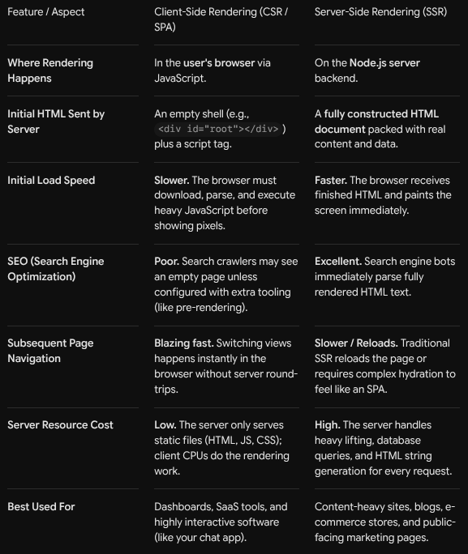
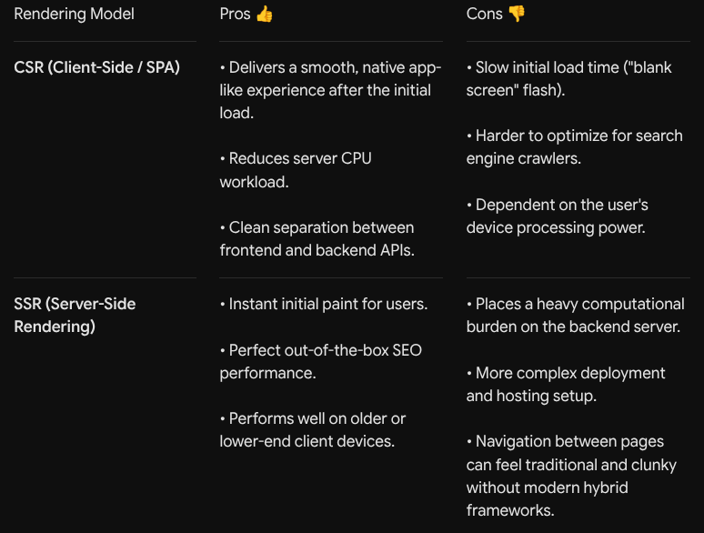

# Views
- Views are the user-facing part of the application, in this case, HTML files. 
- We’ve dealt with views in an earlier project where the server would send HTML files to the user, but these files were static and many of our use cases require views to be dynamic with regards to data.
- We will use template engines to create our views. As the name suggests, we write template files in our codebase that get transformed into HTML when we respond to a server request. 
- Any variables defined in our template files are replaced with actual data. 
- Additionally, we can insert conditional and/or loop logic into our template file, e.g. render the user’s username once they have logged in. 
- This would not be possible with plain HTML. 
- Any client-side JavaScript can still be added via a script tag.
## Difference between Client-Side Rendering(CSR) and Server-Side Rendering(SSR) 
- 
- 